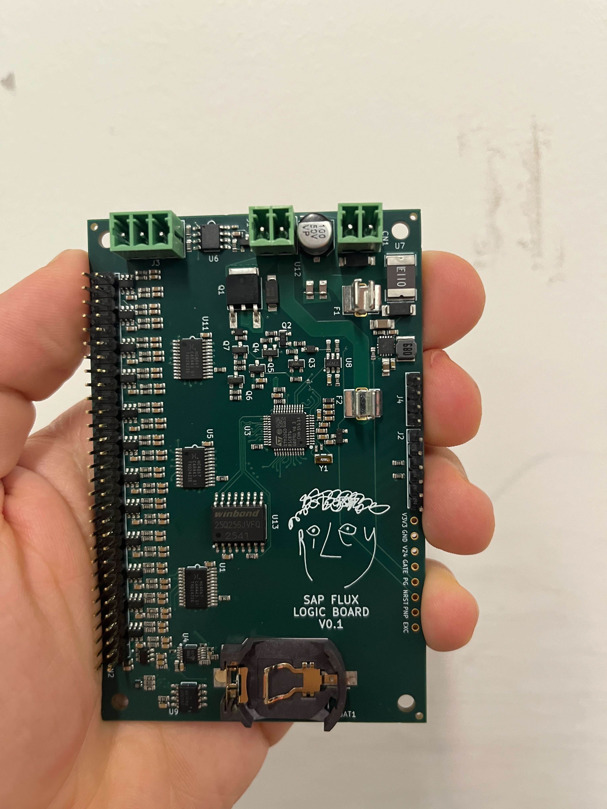

# Sap Flux Logic Board

An open hardware logic board for experimental heat-pulse sap flux sensors.

Sap flux sensors estimate how water moves through trees by watching heat move
through sapwood. That sounds simple until the signal leaves the tree. Probe
spacing, thermal properties, calibration choices, firmware decisions, and
downstream models all shape what a sap flux estimate can mean. My dissertation
work starts from that leak in the measurement pipeline.

This board is the hardware layer for testing a new sap flux method. The method
uses the shape of the heat-pulse trace to solve for thermal parameters and probe
positions that conventional workflows often assume. The goal is cleaner
inference from tree-scale physiology into mortality estimates, forest models,
and water budgets.

## Current Status

The board is real. The first assembled prototype was fabricated by JLCPCB in
March 2026 and is sitting on my desk.

The measurement method has strong simulation results. Field tests are planned
for summer 2026, when I am back in the United States. Those tests need to show
that the physical measurement layer can deliver the information the theory
requires. If it works, I plan to make the board more accessible to other
researchers, revise the topology as needed, and share the design lessons that
survive contact with fieldwork.

## Why This Exists

Heat-pulse sap flux methods depend on a thermal model of wood, water, probe
spacing, and heat movement. Two major problems motivated this design:

- Probe misalignment can add large nonlinear shifts to sap flux estimates.
- Variation in sapwood thermal conductivity can be misread as variation in sap
  velocity.

The second problem may be smaller in raw magnitude, but it matters deeply for
interpretation. Thermal conductivity can covary with wood density, water
potential, stress history, and experimental design. Those processes operate on
different timescales and respond to different environmental drivers. When they
are flattened into apparent sap flux, the error can propagate into tree
mortality models, forest water budgets, and climate-scale inference.

The new method uses information in the heat-pulse trace that standard methods
often average away. It aims to solve directly for heat velocity, thermal
diffusivity, and probe position. Wounding response and other biological
complications remain, but removing these large confounding families makes the
remaining problems easier to isolate.

## What The Board Does

The Sap Flux Logic Board is a field electronics platform for collecting raw,
high-resolution heat-pulse measurements from passive sensor needles.

Design highlights:

- 48 thermistor channels through three analog multiplexers.
- One ADS1115 ADC for heat-pulse temperature traces and excitation sensing.
- Controlled heater output for short, high-power heat pulses.
- Supports up to 120W of raw power output across all attached sensors in short bursts.
- 24V field power input with protection and a 3.3V buck supply.
- RS-485 communication for field data loggers.
- 32 MB SPI flash for local data logging.
- I2C EEPROM for configuration and calibration.
- STM32G0B1 microcontroller target, intended for embedded Rust firmware with
  the [Embassy](https://github.com/embassy-rs/embassy) framework.
- Six-layer KiCad layout with a preserved JLCPCB fabrication package.

Short heat pulses matter. The thermal model smears the pulse over the duration
of heat exposure. Delivering the needed energy quickly can improve the
measurement while keeping the system practical for battery-powered field
deployments. The heater path and watchdog circuitry were designed around that
constraint, with explicit attention to power delivery and safety.

## Compared With Current Workflows

Commercial sap flux systems are expensive, closed, and usually hand researchers
processed estimates with limited access to the raw thermal trace. That limits
the kinds of questions researchers can ask after deployment.

This board is designed around a different workflow:

- Keep the raw signal available.
- Make the thermal assumptions inspectable.
- Support many passive sensing channels from one logic board.
- Cut idle power enough for long field deployments.
- Move configuration into firmware when the hardware can support it.
- Use commodity fabrication so manufacturing scales up, and other researchers can reproduce and modify the design.

As it stands, getting this board manufactured and assembled at volume costs
about $20 per board, and in "just a couple" quantities about $50 per board. When
RS-485 is set to 15-second polling mode, estimated idle power is under 1 mW.

The long-run target is the shift described in the essay: a system closer to
tens of dollars per sensor site, compared with one thousand-dollar black box
per tree. Lower cost and lower idle power matter because the interesting
science often needs more replicates, more sites, and longer deployments than
current instruments make easy.

## Reproducibility

Atopile is the canonical electrical design source for this board:

- [`elec/main.ato`](elec/main.ato)
- [`elec/ato.yaml`](elec/ato.yaml)
- [`elec/`](elec/)

The hand-routed KiCad layout is preserved here:

- [`elec/layouts/default/default.kicad_pcb`](elec/layouts/default/default.kicad_pcb)

The shipped fabrication package is frozen here:

- [`releases/sap-flux-adapter-v1.1-shipped-2026-03-21/`](releases/sap-flux-adapter-v1.1-shipped-2026-03-21/)

That release includes the March 21 Gerbers, drill file, JLCPCB BOM, JLCPCB CPL,
Atopile entrypoint snapshot, KiCad layout snapshot, and checksums. The live
KiCad project is still named `default` because it came from the Atopile build
workflow and then accumulated hand placement, routing, board art, and late
manufacturing fixes.

For more detail, see [`docs/reproducibility.md`](docs/reproducibility.md).

## Design Notes

I'm relatively new to hardware and more experienced with software. I initially
approached this project with software design principles in mind: stuff should
do one thing, composition first, keep scopes narrow and stackable.

But while software is free, hardware is cheap, and I've learned those are extremely different things.

In software, composability is cheap because the connections between pieces can
usually be inspected, tested, swapped, and moved around after the fact. A bad
interface can become a wrapper, a protocol, or a refactor. Hardware makes those
same choices physical. A boundary becomes a connector, cable, enclosure,
assembly step, failure point, and thing somebody has to configure in a forest.

That changes the meaning of modularity. A small board that does one narrow job
can be elegant on a desk and annoying in a field deployment. A more integrated
board may look less pure from a software perspective, but it can make the field
system easier to install, power, seal, debug, and explain.

My current leaning is to put generous capability on the board and move as much
experiment-specific configuration as possible into firmware. That may change as
the board gets used.

The larger question I want to explore is how scientific hardware should be
designed across different contexts, and how those designs can interoperate. The
barrier to entry is falling. The lagging edge of technology is getting very
good for very little money. Commodity microcontrollers, low-power radios,
precision ADCs, flash memory, switching regulators, PCB fabrication, and
pick-and-place assembly have all become good enough that many scientific
instruments can be built from mature parts instead of frontier parts.

That matters because many research tools serve narrow markets where legacy
vendors face limited pressure to improve quickly. A researcher with field
expertise, modern open hardware tools, a few AI collaborators, and a willingness
to learn can now move surprisingly far. Researchers with deep domain expertise
may increasingly be able to improve their own instruments and share those
improvements broadly.

I would like this project to help clarify the standards and practices that make
that work cooperative. The goal is for human researchers and increasingly
capable AI systems to design open scientific tools that connect cleanly, explain
themselves well, and compose into field systems without turning every deployment
into bespoke wiring.

## Tooling

This board exists because modern hardware tooling made the work approachable.

[Atopile](https://atopile.io/) let me describe the electrical design as a
readable source tree instead of treating the schematic as a static artifact.
That made the design easier to inspect, revise, and discuss with coding agents.

[pcbparts](https://pcbparts.dev/) was essential while learning. It helped with
part discovery, package checks, and KiCad/JLCPCB-oriented component work that
would otherwise have meant a much slower loop through datasheets, symbols,
footprints, and stock pages.

I am very grateful to both projects.

## Future Direction

The next phase is empirical. I need to test the sensor method on real trees,
compare the recovered parameters against the theory, and learn which parts of
the board topology should become stable.

Future revisions may change how many sensors each board supports, where the
sensor and logic boundaries sit, and how field communication works. A later
board may integrate LoRa directly while preserving low idle power.

The larger ambition is broader than this one sensor. I want sap flux to become
a practical test case for open scientific instrumentation: cheaper to deploy,
easier to inspect, more faithful to the raw signal, and structured enough that
future researchers and AI systems can understand what each measurement meant.

## Links

- Essay: [Science Is Leaking](https://rileyleff.com/blog/science-is-leaking)
- Specs: [`docs/specs.md`](docs/specs.md)
- Reproducibility notes: [`docs/reproducibility.md`](docs/reproducibility.md)
- Design history: [`docs/design-history/`](docs/design-history/)
- Shipped release: [`releases/sap-flux-adapter-v1.1-shipped-2026-03-21/`](releases/sap-flux-adapter-v1.1-shipped-2026-03-21/)
