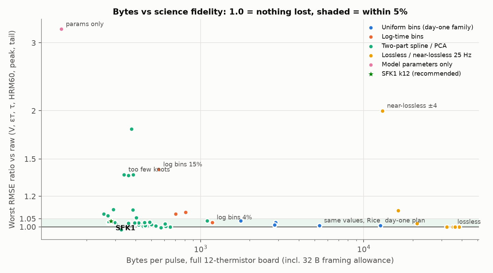
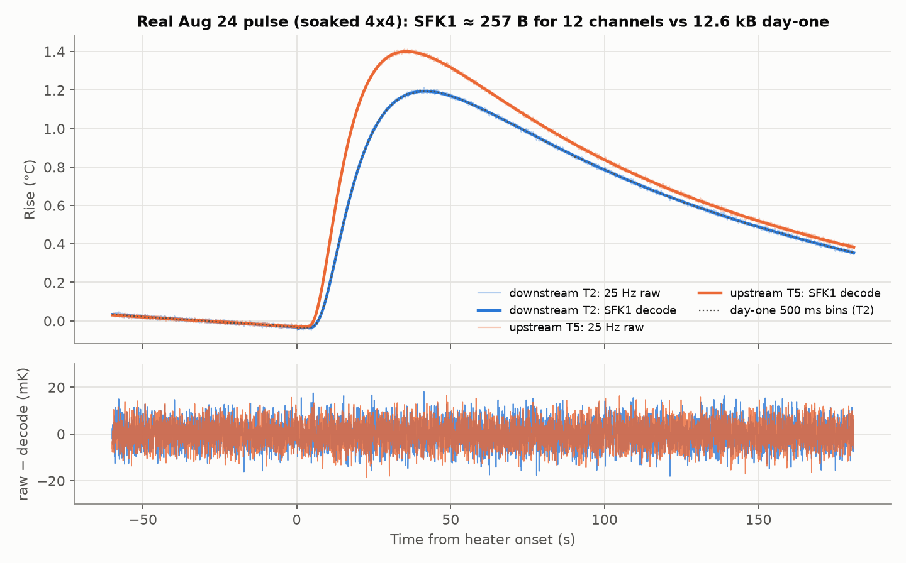

# Storing and sending heat-pulse data: compression research (2026-10-24)

**Question.** What should the board store, and what should it send, for each
heat pulse (60 s baseline + 1 s pulse + 180 s recovery, 13 channels at
25 Hz) so that the science survives? Fidelity is measured on the science, in
units of each estimator's own noise σ.

**Answer.**

| tier | what | bytes/pulse (12 thermistors) | science fidelity |
|---|---|---:|---|
| **every pulse, uplink** | **SFK1**: on-board ratiometric baseline bins + a log-time spline/KLT projection, Rice coded (spec below) | **250** (+ protocol framing) | RMSE vs noise-free ≤ 1.034× raw on V, τ, HRM, tail; Tmax 4× *better* than raw |
| flash, always | lossless 25 Hz raw (mean-of-8 predictor + block Rice) | 35,130 | exact |
| on request | the flash record for a run_id, sent as is | 35,130 | exact |
| fallback / transition | day-one 500 ms bins, same values but Rice-coded | 5,324 | same as day-one (≈ raw) |

SFK1 is **50× smaller than the day-one 500 ms tier** (12,616 B payload) and
loses no measurable velocity information: V RMSE ratio 1.008, p95 shift
0.90 σ on the synthetic corpus and ≤ 0.98 σ on the two real pulses. Once
the payload is about 250 B, **radio wakes cost more energy than the bytes**.
Batch pulses into 1 to 4 uplinks a day; that matters more than any further
compression.



## 1. Data we have (survey.py → survey.md)

Only **three real pulses** exist, all on the bench, all with one probe:

* `session_20260824_203902` run 1787618451: 0.99 s pulse into **soaked 4x4
  wood**, peak rise about 1.3 °C, noise 6.2 mK, T1 broken (stuck at 10 counts).
  This is the best capture.
* `session_20260711_005525` run 1783745735: 0.48 s pulse, medium
  undocumented, peak rise 0.6 to 0.8 °C, **only 30 s of baseline**, noise 12 mK,
  T3 broken.
* `session_20260711_002159` run 1783743736: a 0.04 °C "null" pulse (probe
  not coupled). Used only for anomaly tests.

The idle stretches show **two noise regimes**:

* quiet: σ ≈ 1.5 counts at 25 Hz, white plus 1/f;
* interference: 9.6 to 9.8 Hz tones, σ 2.8 to 4.1 counts. Seen in two
  sessions, over an hour in total.

Mean absolute cross-channel correlation is 0.33 to 0.42. Sessions 233040,
233150 and 233529 are simulator output. There is no living-tree data.

Because there are so few real pulses, the encoders are judged on a
**semi-synthetic corpus**: 12 sets of signals × 8 noise draws. Each signal
is a Marshall finite-pulse response with a realistic spread of V, k, ε and
amplitude (−4 to 32 cm/h). On top of that it carries:

* the **systematic model misfit measured on the real Aug pulse**;
* baseline drift and curvature;
* **real recorded idle noise**, from both regimes.

The board's true 13-channel noise, the excitation channel included, is
therefore present. The two usable real pulses are tested as well. Their σ
comes from Monte Carlo: real idle noise is added to a denoised copy of each
pulse.

## 2. How fidelity is measured (harness.py)

The server-side estimators all run on the decoded window:

* Marshall fit: V, ζ, ε·τ, τ;
* HRM α over 30–50, 60–80 and 90–110 s;
* Tmax (Savitzky-Golay plus a parabola);
* peak rise, tail mean and baseline temperature.

Three numbers are reported for each encoder:

* **RMSE ratio vs noise-free**: RMSE(encoded − noise-free estimate) /
  RMSE(raw − noise-free estimate), on the synthetic corpus. **1.00 means
  nothing was lost**; below 1 means the representation removes noise.
  This is the headline metric.
* **p95 |shift| / σ**: the shift from the estimate on raw data, in units of
  that estimator's σ. This penalises denoising, so it overstates the loss for
  smooth codecs. It is still useful as a guarantee that results stay close
  to the raw-data numbers.
* **Real-pulse max |shift| / σ**: the same, on the two real pulses.

## 3. Results (exp_encoders.py, encoder_spec.py → results/*.json)

Bytes are for a full 12-thermistor board.

| encoder | bytes | V | εт | τ | HRM60 | Tmax | peak | tail | p95 V / εт (σ) | real max V (σ) |
|---|---:|---:|---:|---:|---:|---:|---:|---:|---|---:|
| day-one 500 ms i16 (docs plan) | 12,648 | 1.008 | 0.96 | 1.00 | 0.99 | 0.98 | 0.98 | 0.99 | 0.63 / 1.53 | 0.48 |
| same values, Rice-coded | 5,356 | identical | | | | | | | | |
| 1000 ms bins, Rice | 2,879 | 1.026 | 0.98 | 1.02 | 1.01 | 0.93 | 0.96 | 1.00 | 0.65 / 1.72 | 1.61 |
| log-time bins 4% | 1,177 | 1.024 | 0.97 | 1.03 | 1.00 | 0.91 | 0.92 | 1.00 | 1.03 / 1.74 | 1.74 |
| log-time bins 8% | 809 | 1.034 | 0.98 | **1.09** | 1.00 | 0.69 | 0.87 | 1.00 | 1.10 / 1.76 | 2.05 |
| log-time bins 15% | 553 | 1.059 | 0.98 | **1.41** | 1.00 | 0.76 | 0.94 | 0.99 | 1.92 / 2.49 | 1.78 |
| two-part spline12, adaptive Golomb | 444 | 0.998 | 0.94 | 0.98 | 1.02 | 0.26 | 0.87 | 0.98 | 1.05 / 2.26 | 0.83 |
| two-part physics-PCA 8 | 361 | 0.995 | 0.93 | 0.97 | 1.02 | 0.21 | 0.84 | 0.98 | 0.98 / 2.04 | 0.72 |
| tp2 k8 KLT + k-table | 271 | 1.023 | 1.00 | 1.00 | 1.03 | 0.26 | 0.90 | 1.00 | 1.52 / 3.57 | **3.26** |
| tp2 k12 KLT + k-table | 287 | 1.008 | 0.94 | 0.99 | 1.03 | 0.25 | 0.88 | 1.00 | 1.01 / 2.17 | 0.39 |
| tp2 k16 KLT + k-table | 304 | 1.023 | 0.96 | 1.01 | 1.00 | 0.28 | 0.85 | 1.01 | 1.03 / 2.21 | 0.60 |
| **SFK1 k12 (bit-exact spec)** | **254** | **1.008** | **0.94** | **0.99** | **1.03** | **0.25** | **0.88** | **1.00** | **0.90 / 2.16** | **0.98** |
| SFK1 k16 | 270 | 1.022 | 0.96 | 1.01 | 1.01 | 0.28 | 0.85 | 1.01 | 0.91 / 2.59 | 1.36 |
| model parameters only (fit on board) | 140 | 0.96 | 1.00 | 1.04 | **1.44** | 0.90 | **2.96** | **3.26** | 4.02 / 0.37 | 2.03 |
| lossless mean8 + block Rice | 35,161 | 1 | 1 | 1 | 1 | 1 | 1 | 1 | 0 | 0 |
| (ideal 0th-order entropy bound) | 32,211 | | | | | | | | | |
| near-lossless ±2 counts | 16,240 | 1.054 | 1.10 | 1.08 | 1.05 | 1.06 | 1.04 | 1.04 | 1.85 / 2.17 | 4.12 |
| near-lossless ±4 counts | 13,019 | 1.378 | 1.75 | 2.00 | 1.23 | 1.35 | 1.16 | 1.14 | 5.71 / 7.70 | 4.75 |

How to read the table:

* Columns V through tail are RMSE ratios vs noise-free.
* "tp2" rows include a 32 B framing allowance. SFK1 rows count only its own
  6 B header.
* The εт p95 shift of about 2σ coexists with an RMSE ratio of 0.94. The shift
  is noise being removed, not information being lost: εт is the
  worst-determined parameter.



## 4. Recommendations, ranked

1. **Every pulse, uplink: SFK1 k12, about 250 B** (spec in §5).
   * It keeps the full 241 s curve of every channel as 16 numbers plus 12
     baseline bins, so any server estimator can be rerun. It is
     reprocessable, not just a set of parameters.
   * At 24 pulses/day it is about 0.21 MB/month with one wake/day; 0.43 MB
     at 48 pulses/day.
   * Use k = 12. k = 16 costs 7% more bytes and was no better on these data.
     k = 8 fails on the real pulses (V 3.3σ).
   * Quantization step q = 1.5 (297 B in the tp2 sweep, +3.5%) is the next
     notch up in fidelity if wanted.
2. **Flash: lossless 25 Hz raw**, 35 kB/pulse.
   * The mean-of-8 predictor with Rice blocks of 32 samples and a 4-bit k per
     block comes within 9% of the ideal entropy bound.
   * That is 36 days at 24/day (18 days at 48/day) on 29 MiB usable of the
     32 MiB flash, as a ring buffer.
   * The day-one plan stored 500 ms bins. Lossless raw costs 2.8× more flash
     but makes every past pulse fully recoverable for the last month.
3. **On request: the raw flash record by run_id.** About 35 kB over LTE-M is
   about 3.5 wakes' worth of energy (see §6). Pull it when the server's
   anomaly checks fire (§7), or a random 1-in-50 sample for QA.
4. **Transition / fallback: keep the day-one bins but Rice-code them**
   (5.3 kB, identical science, 2.4× smaller). It is a one-day change if SFK1
   slips. Log-time bins (4%, 1.2 kB) are the simplest encoder that is still
   ≤ 1.03 on everything.
5. **Idle temperature.** Each SFK1 record already carries 12 × 5 s baseline
   means every pulse interval, which is free. Continuous 5-min means at 10 mK
   cost 2.2 to 3.9 kB/day for 12 channels: more than all 24 pulses
   (6 kB/day) and dominated by drift between means (exp_idle.py). Add this
   only if the science needs sub-30-min stem temperature.

## 5. On-board encoder spec: SFK1

Reference implementation: `encoder_spec.py`. It has a bit-exact writer and
reader, a round-trip test (0 mismatches over 98 windows) and a fixed-point
emulation. Firmware constants are in `results/encoder_constants.json`: the
16×16 `M_enc` and `D_dec` matrices, `H1`, `Ht` and the Rice k-table, for
k = 12 and k = 16.

**Algorithm.** Per window: 1500 samples before onset and 4526 from onset,
at 25 Hz.

1. **Ratiometric, on board, in Q3 counts.**
   * `y8 = round(8·raw·E_ref / exc13)`. exc13 is a centred 13-sample boxcar
     of the excitation channel; E_ref is the mean excitation over the first
     5 s.
   * The excitation channel is not sent. exp_noise.py shows why it must be
     applied at about 2 Hz resolution: a constant or window-line excitation
     doubles σ on V and HRM (fig_noise.png). A 0.5 s boxcar is as good as
     per-sample.
2. **Baseline.** Twelve 5 s bins: `b[i] = round(mean y8)`. The decoder's
   line is a least-squares fit through (bin centre, b/8).
3. **Rise projection.**
   * `r = y8/8 − line` for t ≥ 0. Project it onto 16 cubic B-splines in
     `u = ln(t + 2 s)` (12 uniform interior knots on [ln 2, ln 183]).
   * Rotate by `M = Vᵀ R⁻ᵀ`, where R comes from the QR of the basis and V is a
     KLT trained on Marshall curves only. Quantize `ci = round(c / 3.0
     counts)`.
   * Because `Bᵀ·line = a·H1 + b·Ht`, with H1 and Ht constant, the board can
     **accumulate `G = Bᵀ y8` while sampling and never buffer the window**.
4. **Coding.** Rice codes with a per-index constant k-table plus a 2-bit
   per-channel offset; baseline deltas use one Rice k per channel.

**Byte layout** (MSB first):

| field | bits | notes |
|---|---:|---|
| version | 8 | `0x50 \| knots/4` (0x53 = 12 knots) |
| live mask | 16 | bit c−1 = thermistor c present |
| E_ref | 16 | excitation counts |
| NB | 8 | number of baseline bins (12) |
| *per live channel:* | | |
| b[0] | 19 | unsigned, Q3 counts |
| kb | 4 | Rice k for the baseline deltas |
| b[i] − b[i−1], i = 1..NB−1 | Rice(kb), zigzag | mean ≈ 9 B/channel together with b[0] |
| o | 2 | k-table offset −1..+2 |
| ci[0..15] | Rice(max(0, K[j]+o)), zigzag | K = (12, 9, 7, 5, 3, 2, 0 × 10) |
| pad | 0–7 | to a byte |

The Rice escape is 24 one-bits followed by the raw 20-bit zigzag value.

Header 6 B plus about 20.3 B/channel gives a mean of 250 B for 12 channels
(range 77 to 278 B; real 5-channel windows are smaller). Run id, onset time
and CRC are the field protocol's framing and are not counted.

**Decoder.** Pre-onset: line + linear interpolation of the bin residuals.
Post-onset: `line + B·D·(ci·3.0)` with `D = R⁻¹V`. The decoder never has to
reproduce the encoder's arithmetic. Any arithmetic error on the board shows
up 1:1, in counts, in the reconstruction.

**Firmware cost** (Cortex-M0+ at 64 MHz, no FPU, no divider; estimates):

| item | estimate | basis |
|---|---|---|
| per post-onset sample | ≈ 930 cycles (0.04% CPU at 25 Hz) | 1 soft reciprocal + 12 multiplies for the ratio; fixed-point ln + 4 cubic B-spline values (Q12); 48 i32×Q12 MACs into i64 |
| whole window | ≈ 4.8 M cycles ≈ 76 ms, spread over 241 s | |
| end of window | ≈ 0.45 M cycles ≈ 7 ms | 12 × (16×16 soft-float MAC, line removal, Rice) |
| RAM | ≈ 3.5 KB | 12×16 i64 G, 12×12 i32 bin sums, exc ring, output buffer; no window buffer |
| const flash | ≈ 1.2 KB tables + ≈ 2 KB code | M (16×16 f32), H1, Ht, k-table |
| fixed-point effect | Q12 basis + i64 + f32 M changed ≥ 1 index by ±1 in 16% of channels; science unchanged (same RMSE ratios to 3 decimals) | `encode(fixed_point=True)` |

The lossless flash tier also streams. It needs the last 8 samples per
channel plus one 32-sample block: about 1.3 KB RAM.

## 6. Bytes, flash and energy (exp_budget.py → results/budget.json)

All of these are at 24 pulses/day.

| tier | payload B | flash days | MB/month (1 wake/day) | radio J/day: wake per pulse / 4 per day / 1 per day |
|---|---:|---:|---:|---|
| day-one i16 | 12,616 | 100 | 9.7 | 28.1 / 18.0 / 16.5 |
| day-one Rice | 5,324 | 235 | 4.1 | 18.9 / 8.8 / 7.3 |
| log bins 4% | 1,145 | 1,077 | 0.90 | 13.7 / 3.5 / 2.0 |
| **SFK1 k12** | **250** | — | **0.21** | **12.5 / 2.4 / 0.85** |
| lossless | 35,129 | 36 | 27.0 | 56.5 / 46.4 / 44.9 |

Assumptions, all editable in ASSUME:

* 24 B record header per pulse;
* 1,100 B datagrams with 57 B IP/UDP/DTLS overhead;
* 120 B of ack/signalling per wake;
* a wake (RRC setup + tail, with RAI) costs as much energy as sending 10 kB,
  anchored at 0.5 J.

With SFK1, a wake per pulse spends 15× more radio energy than one wake a
day. Bytes are then about 41% of the radio energy at 1 wake/day, so further
compression has little left to win. At $0.50/MB, SFK1 costs about
$0.10/month vs $4.90 for day-one i16.

## 7. Anomaly flags from the compact record (exp_anomaly.py)

Thresholds are taken from the 99.5th percentile of normal windows. Faults were
injected into 48 windows each.

| fault | detected by | rate |
|---|---|---:|
| ADC spikes (±300 counts) | per-channel max \|residual\| | 100% |
| step offset (+40 counts) | per-channel max \|residual\| | 100% (residual RMS: 73%) |
| heater did not fire | first KLT coefficient ≈ 0 (server-side, already in SFK1) | 100% |
| half amplitude (bad contact) | first KLT coefficient vs history | 100% |
| broken thermistor | b[0] ≈ 83 Q3 counts (10 counts raw); already in SFK1 | yes |
| real "null" pulse, Jul 11 | \|first coefficient\| ≤ 26 vs 2,100 to 7,100 normally | yes |

Residuals are invisible to the server, so **add an optional 1-byte
saturating max |residual| per channel (+12 B, about 5%)**. It is not in the
reference implementation yet. The board also caught a **real glitch**: a
single-sample +64-count spike on T3 at t = 0.97 s in the Aug pulse, at
heater turn-off. SFK1 smooths it away; the flag would fire. Use these flags
to trigger the on-request raw pull.

## 8. What did not work

* **Near-lossless (±δ counts) on 25 Hz raw.** ±2 costs 5 to 10% fidelity and
  ±4 costs up to 2× σ, yet it still needs 13 to 16 kB. The noise
  (1.5 counts) is what carries the information at 25 Hz; quantizing it
  coarsely before averaging throws signal away. Average first, then
  quantize.
* **Model parameters only** (Marshall fit on the board, 140 B). V is fine
  (0.96), but HRM60 is 1.44, peak 2.96 and tail 3.26: the model misfit is
  real and systematic (seen on the Aug pulse). It cannot be reprocessed, and
  it needs a nonlinear fit on an M0+.
* **Log-time bins at 15%.** τ rises to 1.41. Below about 800 B, bins lose to
  projections.
* **Adaptive arithmetic coding** (606 B vs 456 B Rice on the same
  coefficients). Too few symbols with a heavy-tailed spread for the model to
  learn. The static per-index k-table, the "trained prior", is what wins:
  it saves 45% of the coefficient bits when combined with the KLT.
* **KLT with an adaptive coder:** 486 B vs 452 B without the KLT. The
  rotation only pays off when the coder knows the per-index scale.
* **Global polynomial + spline in one least-squares fit.** Collinearity made
  quantization error grow 4 to 33σ. This led to the two-part design:
  baseline bins plus an orthonormal post-onset basis.
* **Coarser baseline** (10 s bins or a 2× step). It saves 17 to 33 B but
  HRM60 goes to 1.07–1.08 and V to 1.03–1.05. The baseline is noise-limited
  and sets the detrend for every estimator.
* **Inter-pulse prediction** (exp_sequence.py; a synthetic 48-pulse diurnal
  day). Predicting the coefficients from the previous acknowledged pulse saves
  only 4.5% (288 → 275 B), and 1.3% with a 4-pulse-old reference. Noise
  dominates every coefficient but the first two. Not worth the dependency
  chain.
* **Slope-predicted baseline deltas:** no gain over plain deltas.
* Not tried and expected to be small: **wavelets** (the log-time spline is
  already a matched multi-resolution basis), **down/up sum-difference**
  (cross-channel correlation is mostly common-mode interference, which the
  ratiometric step already removes), and **subtractive dither** (quantization
  steps are at or below the noise σ, so the noise already dithers).

## 9. Surprising findings

* **The day-one bins carry about 2.4× redundancy.** Rice-coding the same
  i16 values gives 5.3 kB with identical science. That is a free win for any
  firmware.
* **The decoded curve gives Tmax 4× more accurately than raw** (RMSE ratio
  0.25). The server's Savitzky-Golay Tmax is noise-limited. Fit Tmax on a
  smooth representation, whatever the transport.
* **Excitation matters more than expected:** constant excitation doubles σ on
  V and HRM. Excitation drifts on a seconds scale, so it must be applied on
  the board (ratiometric) or sent at ≥ 2 Hz.
* **Wake energy, not bytes, is the cost** once payloads are below about
  1 kB.
* A real **heater turn-off glitch** (one sample, +64 counts) on the Aug
  board.

## 10. Caveats, and what needs more data

* **Only two usable real pulses, both bench, one probe, 50 Hz decimated to
  25 Hz.** The corpus is semi-synthetic. Its misfit templates come from a
  single pulse, so a living tree with a different misfit shape could need
  more coefficients. KLT/k-table mismatch costs bytes, never fidelity, but
  more knots could be needed.
  * **First field deployment: store lossless and pull the raw record for a
    few dozen pulses.** Then rerun exp_encoders.py with those as the test
    set, and retrain the KLT/k-table if the bytes grow.
* The noise windows overlap (40 to 60 s strides within 15 to 70 min of idle),
  so per-set σ values are approximate. The interference regime may differ in
  the field.
* Field timing (2 probes, 25 Hz, 13-channel ADS1115 round-robin) is
  untested. SFK1 assumes a fixed 25 Hz grid. Jitter only perturbs the
  basis slightly, but a missing sample has to be flagged.
* Pulses at 48/day and diurnal drift are synthetic. Idle summary costs were
  measured on bench drift, not in a stem.
* Radio energy numbers are assumptions. Measure one LTE-M wake on the actual
  nRF9160 + SIM and update ASSUME.

## 11. Thermistor geometry and table classes (exp_geometry.py → results/geometry.json)

**Question.** SFK1's KLT rotation V and its Rice k-table were trained on
East30 0.6 cm axial curves. Would other thermistor positions need their own
tables (per-channel "geometry classes"), or is one shared set enough?

**Method.**
* **Curves.** An isotropic 2D moving finite line source, with flow along
  the axis. On the axis it equals `fit_4x4_pulse.finite_pulse_response`
  (max relative difference 5e-16).
* **Positions.** Axial downstream and upstream at 0.5, 0.6, 0.75 and
  1.0 cm; tangential at 0.6 cm; 45° diagonals, downstream and upstream, at
  0.6 cm.
* **Physics,** drawn as `klt_rotation` does: k 0.0016–0.0034 cm²/s,
  v −4..32 cm/h, ±10 % radial spacing error plus ±0.03 cm lateral offset,
  and a 1 s pulse.
* **Amplitudes are physical.** The peak goes as about 1/r², and a 0.6 cm
  curve at v = 0 peaks at 280–420 counts.
* **Test windows.** Full 60 + 181 s windows with ±40 mK/min drift, ±2
  mK/min² curvature and 1.5-count white noise at 25 Hz. The line is fitted
  from the twelve Q3 baseline bins, as in SFK1.
* **Coding.** Quantization step 3 counts, Rice coding with the K-table plus
  the 2-bit offset, exactly as SFK1 does.
* **Draws.** 800 training curves and 500 independent test curves per
  geometry.

**Strategies:**
* A: the shipped tables.
* A′: the same training procedure on this simulator, using East30 0.6 cm
  up + down only.
* Ak: the shipped V with a per-geometry k-table.
* B: one V + k-table trained on all geometries.
* C: B's V with a per-geometry k-table.
* S: a per-spacing class, with V + k-table trained on up + down at that
  distance (tangential and diagonal positions use the 0.6 cm class).
* D: a per-geometry V + k-table.

Coefficient bits per channel (including the 2-bit offset; baseline bits
are the same in every strategy), test mean:

| geometry | peak (counts, median) | A | A′ | Ak | B | C | S | D |
|---|---:|---:|---:|---:|---:|---:|---:|---:|
| ax_dn_0.5 | 714 | 115.3 | 112.7 | 96.2 | 97.2 | 91.5 | 83.2 | 81.3 |
| ax_dn_0.6 | 511 | 80.9 | 81.9 | 77.9 | 88.8 | 87.6 | 81.9 | 79.0 |
| ax_dn_0.75 | 377 | 90.3 | 92.0 | 85.1 | 90.1 | 88.0 | 78.5 | 76.5 |
| ax_dn_1 | 230 | 122.3 | 124.3 | 97.6 | 93.5 | 88.8 | 74.8 | 70.4 |
| ax_up_0.5 | 330 | 91.3 | 90.2 | 86.2 | 82.5 | 82.2 | 72.1 | 71.3 |
| ax_up_0.6 | 207 | 68.0 | 68.6 | 69.5 | 74.0 | 76.1 | 68.6 | 68.3 |
| ax_up_0.75 | 114 | 69.7 | 70.8 | 70.8 | 72.4 | 73.5 | 64.2 | 63.2 |
| ax_up_1 | 49 | 78.1 | 80.1 | 74.2 | 71.0 | 71.3 | 57.9 | 56.9 |
| tan_0.6 | 321 | 72.5 | 73.1 | 72.5 | 79.7 | 79.7 | 73.1 | 71.9 |
| diag45_dn_0.6 | 458 | 78.3 | 79.3 | 76.8 | 85.8 | 84.8 | 79.3 | 77.1 |
| diag45_up_0.6 | 249 | 69.2 | 69.9 | 70.5 | 75.7 | 77.6 | 69.9 | 69.9 |
| **mean, all** | | **85.1** | **85.7** | **79.8** | **82.8** | **81.9** | **73.1** | **71.5** |

The standard error of each difference from A is at most 2.2 bits (largest
at 0.5 cm downstream) and usually 0.1–0.4 bits.

Change in bytes per 12-channel record for a whole East30-style set
(6 downstream, 6 upstream) at one spacing, against A. A typical SFK1 record
is about 250 B.

| set spacing | A′ | Ak | B | C | S | D |
|---|---:|---:|---:|---:|---:|---:|
| 0.5 cm | −2.8 | −18.0 | −20.2 | −24.6 | **−38.4** | −40.4 |
| 0.6 cm | +1.3 | −1.1 | +10.5 | +11.1 | +1.3 | −1.1 |
| 0.75 cm | +2.1 | −3.1 | +1.9 | +1.1 | **−13.1** | −15.2 |
| 1.0 cm | +3.0 | −21.5 | −26.9 | −30.3 | **−50.8** | −54.8 |

**Sanity check.**
* The unquantized projection is identical under every V (maximum
  difference 1e-11 counts).
* Reconstruction RMSE against the noise-free curve agrees across all
  strategies to 3 decimals for every geometry (0.10–0.20 counts).
* Per curve, RMSE differs by at most 0.06 counts, because the
  quantization lattice is rotated.
* The tables cost only bits. A′ reproduces the shipped k-table exactly,
  and its bits are within 3 bits/channel of A, so the simulator matches the
  one the shipped tables were trained on.

**Conclusion.**
* **The rotation is what matters, and the class key is the
  thermistor–heater distance.** At 0.5 and 1.0 cm, the shipped V costs
  about 20–47 bits/channel. A per-spacing V + k-table (S) comes within 0–4.4
  bits of a per-geometry optimum (D). That saves 38 B (0.5 cm), 13 B
  (0.75 cm) and 51 B (1.0 cm) per record, i.e. 5–20 % of 250 B.
* **Per-class k-tables alone (Ak, C) recover only about half of that at
  0.5/1.0 cm and a quarter at 0.75 cm.** The 2-bit offset already
  absorbs amplitude. The loss comes from the curve shifting in ln t, by
  ln(r²/0.36), which pushes energy into indices whose k is 0.
* **One shared table set over all geometries (B) is a poor compromise.**
  It costs every 0.6 cm set 10.5 B per record and still leaves 1.0 cm about
  24 B worse than S.
* **Tangential and diagonal at 0.6 cm, and up versus downstream, need no
  class of their own.** D beats the 0.6 cm tables by ≤ 3 bits/channel
  (≤ 0.4 B) there.
* **Recommendation:** one (V, K) set per probe spacing, i.e. 0.5, 0.6,
  0.75 and 1.0 cm. Each costs ≈ 1 kB of flash (16×16 i32 M, plus 16 B of
  k-table). The record must name its class, e.g. one class id per probe;
  a per-channel id is not needed.
* **Caveat:** simulated white noise and pure Marshall shapes. The real
  misfit and coloured noise of §10 add bits under every strategy alike.

## Reproduce

```sh
cd analysis/compression_research_20261024
R="uv run --with numpy --with scipy --with pandas --with matplotlib python"
$R survey.py          # capture survey -> survey.md/json
$R exp_noise.py       # noise regimes, excitation handling -> fig_noise.png
$R exp_encoders.py    # encoder sweep (~10 min, 16 processes) -> results/encoders.json
$R encoder_spec.py    # SFK1 reference + round trip + constants -> results/encoder_spec.json, encoder_constants.json
$R exp_sequence.py    # inter-pulse prediction
$R exp_anomaly.py     # anomaly flags
$R exp_idle.py        # idle summaries
$R exp_budget.py      # flash / MB / energy
$R exp_geometry.py    # thermistor geometry vs trained tables -> results/geometry.json
$R make_figures.py    # fig_tradeoff.png, fig_reconstruction.png
```

The corpus is cached in `cache/` (about 120 MB, gitignored). Shared code:
`common.py` (loading, conversion, corpus, science), `encoders.py`,
`entropy.py` (coders and the bit writer/reader), `harness.py`.
