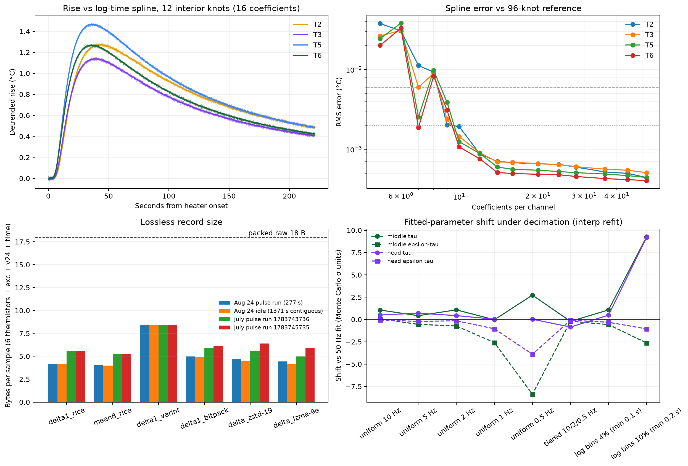

# Sap-flux trace compression study (2026-10-24)

Data: Aug 24 soaked-4x4 run `1787618451` (`session_20260824_203902`), its contiguous idle stretch, and two July 0.5 s pulse runs. Measured rate 47.77 Hz mean (49.80 Hz median; every 50th frame is a 60 ms command window). T1 is broken (constant raw), so per-board projections replace it with the mean cost of the working thermistors.

Regenerate: `uv run --with numpy --with scipy --with pandas --with matplotlib --with zstandard --with lz4 python analysis/compression_study.py`

## Findings

- **Noise sets the lossless floor.** Thermistor noise is ~1.3 counts (≈4.3 mK); the Gaussian floor is ~2.5 bits and a mean-of-8 predictor + Rice reaches ~3.1 bits per thermistor sample. A whole healthy-probe record drops from 18 B to ~4.0 B (≈4.5x on August data, ≈3.4x on the noisier July data). General compressors (zstd/lzma) are at best ~5% better than this simple integer coder, so it is the one to put on the STM32.
- **Lossless 50 Hz everywhere does not fit the flash for long**; pulse windows do (see section 4).
- **A 12–16-knot log-time spline is a faithful lossy archive**: < 1 mK RMS vs the denoised curve and < 1σ shift in τ, ε·τ and V, for ~16–20 coefficients per channel. Below ~10 knots the fitted parameters move by several σ even when RMS error looks small.
- **The Marshall model alone is not an archive**: residual RMSE ≈ 2.3x the noise, so keep its parameters as the *result*, next to a spline.
- **Uniform decimation is safe to ~2 Hz** (≤ ~1.7σ, ≤ 0.01 cm/h); 1 Hz is borderline; 0.5 Hz is not. Tiered and 4% log bins preserve the information (≤ ~1σ after interpolating back to the 50 Hz grid) but must be refit with bin-width weights — refitting the bins directly re-weights the least squares and moves τ by tens of σ. 10% log bins lose information (τ +9σ).
- Monte Carlo σ assumes white noise; real noise is partly colored, so true uncertainty is larger and these σ-scaled shifts are conservative.

## 1. Raw sizes

- protocol Sample on the wire: 54 B
- packed flash record: 18 B (8 x i16 + u16 timestamp delta)

| window | seconds | samples | wire | packed | lossless Rice | lossless lzma |
|---|---:|---:|---:|---:|---:|---:|
| Aug 24 run as recorded | 277 | 13256 | 715.8 kB | 238.6 kB | 53.3 kB | 59.0 kB |
| standard 60 s + 1 s + 180 s | 241 | 11513 | 621.7 kB | 207.2 kB | 46.3 kB | 51.3 kB |

Per day (standard window), one board:

| pulses/day | continuous wire | continuous packed | continuous lossless | windows packed | windows lossless | x2 boards windows lossless |
|---:|---:|---:|---:|---:|---:|---:|
| 24 | 222.9 MB | 74.3 MB | 16.4 MB | 5.0 MB | 1.1 MB | 2.2 MB |
| 48 | 222.9 MB | 74.3 MB | 16.4 MB | 9.9 MB | 2.2 MB | 4.4 MB |

## 2. Lossless coding of raw counts

Bits per channel-sample, Aug 24 pulse run (16 bits raw):

| channel | noise σ (counts) | Gaussian floor | Δ1 entropy | mean8 entropy | Δ1 Rice | Δ2 Rice | mean8 Rice | Δ1 varint | Δ1 bitpack | planar zstd-19 | Δ zstd-19 | Δ lzma | Δ lz4 |
|---|---:|---:|---:|---:|---:|---:|---:|---:|---:|---:|---:|---:|---:|
| excitation_raw | 2.83 | 3.55 | 4.05 | 3.74 | 4.19 | 4.96 | 3.94 | 8.00 | 5.06 | 5.40 | 4.98 | 4.63 | 7.52 |
| v24_raw | 17.62 | 6.19 | 6.66 | 6.21 | 6.87 | 7.69 | 6.54 | 8.03 | 7.32 | 7.57 | 8.20 | 7.00 | 12.02 |
| t1_raw | 0.55 | 1.18 | 1.68 | 1.22 | 1.89 | 2.72 | 1.89 | 8.00 | 2.76 | 1.60 | 1.79 | 1.81 | 2.82 |
| t2_raw | 1.34 | 2.47 | 2.97 | 2.72 | 3.15 | 3.91 | 3.05 | 8.00 | 4.02 | 4.71 | 3.60 | 3.44 | 5.38 |
| t3_raw | 1.32 | 2.45 | 2.95 | 2.70 | 3.14 | 3.90 | 3.04 | 8.00 | 4.05 | 4.61 | 3.57 | 3.43 | 5.36 |
| t4_raw | 1.30 | 2.42 | 2.92 | 2.67 | 3.10 | 3.87 | 3.02 | 8.00 | 3.97 | 4.56 | 3.57 | 3.39 | 5.29 |
| t5_raw | 1.34 | 2.47 | 2.97 | 2.73 | 3.15 | 3.91 | 3.05 | 8.00 | 4.06 | 4.82 | 3.60 | 3.46 | 5.36 |
| t6_raw | 1.29 | 2.41 | 2.91 | 2.68 | 3.10 | 3.87 | 3.02 | 8.00 | 3.95 | 4.62 | 3.51 | 3.40 | 5.28 |

Projected bytes per sample for a healthy probe (6 thermistors + exc + v24 + Rice-coded timestamp):

| segment | Δ1 entropy | mean8 entropy | Δ1 Rice | mean8 Rice | Δ1 varint | Δ1 bitpack | planar zstd-19 | Δ zstd-19 | Δ lzma | ratio vs 18 B (mean8 Rice) |
|---|---:|---:|---:|---:|---:|---:|---:|---:|---:|---:|
| Aug 24 pulse run (277 s) | 3.98 | 3.70 | 4.16 | 4.02 | 8.44 | 4.99 | 5.55 | 4.76 | 4.45 | 4.48x |
| Aug 24 idle (1371 s contiguous) | 3.96 | 3.64 | 4.13 | 3.97 | 8.44 | 4.93 | 4.77 | 4.53 | 4.20 | 4.53x |
| July pulse run 1783743736 | 5.19 | 4.97 | 5.55 | 5.27 | 8.40 | 5.92 | 5.20 | 5.55 | 4.99 | 3.41x |
| July pulse run 1783745735 | 5.19 | 4.95 | 5.55 | 5.28 | 8.45 | 6.15 | 6.91 | 6.41 | 5.95 | 3.41x |

Timestamps: delta-of-delta + Rice = 3.44 bits/sample at 0.1 ms (7.03 at 1 µs) (period p1/p50/p99 = 20063/20081/60137 µs).

## 3. Lossy reductions (temperature units)

Pulse 0.987 s; peak detrended rise 1.480 °C, so decimated values fit i16 at 0.1 mK resolution (2 B each). One ADC count ≈ 3.21 mK near 20 °C. Spline domain starts at t = 1.19 s (heater-on samples carry an electrical step, not thermal signal).

### 3a. Decimation by bin averaging, refit with `fit_4x4_pulse.fit_pair`

Shifts are vs the 50 Hz fit, in units of the Monte Carlo 1σ measurement scatter (section 3c; white-noise only, so a lower bound on real uncertainty). `native` refits the reduced points directly (nonuniform bins re-weight the least squares); `interp` linearly interpolates the reduced rise back onto the 50 Hz grid first, keeping the original weighting — this isolates information loss.

| scheme | points | 6-ch bytes | mid τ native/interp | mid ε·τ native/interp | mid V native/interp | head τ native/interp | head ε·τ native/interp | head V native/interp |
|---|---:|---:|---:|---:|---:|---:|---:|---:|
| uniform 10 Hz | 2776 | 33.3 kB | +1.20σ / +1.06σ | +0.19σ / +0.07σ | +1.66σ / +1.55σ | +0.54σ / +0.50σ | -0.10σ / -0.06σ | +0.25σ / +0.29σ |
| uniform 5 Hz | 1388 | 16.7 kB | +0.60σ / +0.43σ | -0.29σ / -0.55σ | -1.44σ / -1.71σ | +0.81σ / +0.71σ | -0.17σ / -0.21σ | -0.28σ / -0.31σ |
| uniform 2 Hz | 556 | 6.7 kB | +1.13σ / +1.08σ | -0.12σ / -0.73σ | +0.86σ / +0.26σ | +0.32σ / +0.44σ | +0.13σ / -0.14σ | +0.75σ / +0.51σ |
| uniform 1 Hz | 278 | 3.3 kB | -0.40σ / -0.03σ | -1.02σ / -2.58σ | -1.25σ / -2.78σ | -0.77σ / +0.03σ | -0.46σ / -1.04σ | -0.59σ / -1.09σ |
| uniform 0.5 Hz | 140 | 1.7 kB | +0.78σ / +2.73σ | -3.11σ / -8.38σ | -5.78σ / -10.92σ | -3.49σ / +0.03σ | -2.12σ / -3.89σ | -5.29σ / -6.81σ |
| tiered 10/2/0.5 Hz | 418 | 5.0 kB | +57.22σ / -0.21σ | +4.90σ / -0.19σ | +12.44σ / -0.47σ | +63.10σ / -0.85σ | +11.95σ / -0.08σ | +30.14σ / -0.27σ |
| log bins 4% (min 0.1 s) | 197 | 2.4 kB | +34.72σ / +1.07σ | +4.39σ / -0.57σ | +9.23σ / -0.92σ | +34.75σ / +0.49σ | +9.92σ / -0.31σ | +20.70σ / -0.51σ |
| log bins 10% (min 0.2 s) | 117 | 1.4 kB | +36.07σ / +9.27σ | +2.17σ / -2.63σ | +5.68σ / -3.73σ | +36.67σ / +9.20σ | +8.62σ / -1.06σ | +18.99σ / -1.34σ |

Reference (50 Hz): middle τ 152.68 s, ε·τ 6.911 s, V +0.442 cm/h; head τ 143.79 s, ε·τ 3.800 s, V -0.223 cm/h.

### 3b. Least-squares cubic spline in u = log(t + 2 s), t ≥ 0

Error is measured against a 96-knot reference spline (≈ the noise-free curve; its own noise leakage is ~σ·√(100/N) ≈ 0.5 mK). Coefficients = knots + 4.

| channel | noise σ (°C) | peak (°C) | 1 kn | 2 kn | 3 kn | 4 kn | 5 kn | 6 kn | 8 kn | 10 kn | 12 kn | 16 kn | 20 kn | 24 kn | 32 kn | 40 kn | 48 kn |
|---|---:|---:|---:|---:|---:|---:|---:|---:|---:|---:|---:|---:|---:|---:|---:|---:|---:|
| T2 RMS (mK) | 0.0065 | 1.288 | 37.67 | 30.54 | 11.22 | 9.26 | 2.02 | 1.93 | 0.88 | 0.70 | 0.68 | 0.66 | 0.65 | 0.60 | 0.52 | 0.50 | 0.44 |
| T3 RMS (mK) | 0.0062 | 1.153 | 26.37 | 30.90 | 5.98 | 8.97 | 2.39 | 1.44 | 0.90 | 0.69 | 0.69 | 0.66 | 0.64 | 0.60 | 0.56 | 0.55 | 0.51 |
| T5 RMS (mK) | 0.0061 | 1.480 | 24.38 | 38.11 | 2.53 | 9.74 | 3.88 | 1.24 | 0.88 | 0.60 | 0.56 | 0.55 | 0.53 | 0.51 | 0.49 | 0.47 | 0.44 |
| T6 RMS (mK) | 0.0056 | 1.286 | 20.10 | 32.93 | 1.87 | 8.23 | 3.09 | 1.07 | 0.76 | 0.51 | 0.50 | 0.49 | 0.48 | 0.45 | 0.43 | 0.42 | 0.40 |
| T2 max (mK) | | | 462.3 | 194.9 | 108.1 | 79.9 | 12.8 | 10.5 | 7.0 | 5.9 | 5.9 | 6.0 | 4.9 | 6.9 | 7.2 | 4.8 | 3.0 |
| T3 max (mK) | | | 366.1 | 230.4 | 63.1 | 74.8 | 18.3 | 8.5 | 8.1 | 7.2 | 7.1 | 7.5 | 5.9 | 5.4 | 6.7 | 5.6 | 5.5 |
| T5 max (mK) | | | 371.3 | 324.5 | 28.4 | 90.3 | 40.4 | 7.3 | 6.6 | 4.9 | 6.4 | 6.5 | 5.4 | 5.4 | 4.8 | 4.7 | 5.0 |
| T6 max (mK) | | | 311.4 | 288.4 | 13.5 | 68.9 | 28.3 | 6.0 | 6.3 | 4.5 | 5.8 | 5.6 | 5.4 | 4.9 | 4.1 | 4.2 | 4.4 |

Minimum interior knots (worst channel): RMS < 6 mK → **5**, RMS < 2 mK → **6**, max < 6 mK → **20**.

Parameter shift when the fit runs on the spline reconstruction, vs the fit on the 96-knot (denoised) reconstruction, in Monte Carlo σ:

| knots | coeffs/ch | mid τ | mid ε·τ | mid V | head τ | head ε·τ | head V |
|---:|---:|---:|---:|---:|---:|---:|---:|
| 5 | 9 | +2.50σ | +4.02σ | +3.88σ | +0.86σ | -1.41σ | -1.30σ |
| 6 | 10 | +0.93σ | +2.77σ | +3.27σ | +0.30σ | +0.95σ | +1.04σ |
| 8 | 12 | -0.69σ | -1.59σ | -1.61σ | -0.39σ | -1.17σ | -1.07σ |
| 12 | 16 | -0.53σ | -0.76σ | -0.81σ | -0.06σ | -0.19σ | -0.15σ |
| 16 | 20 | -0.27σ | -0.43σ | -0.45σ | -0.07σ | -0.17σ | -0.20σ |
| 20 | 24 | -0.34σ | -0.46σ | -0.50σ | -0.08σ | -0.20σ | -0.21σ |

Denoising alone (96-knot fit vs raw 50 Hz fit): middle V -0.0018 cm/h, ε·τ -0.11%; head V -0.0009 cm/h, ε·τ -0.09% (log-ratio α is biased by noise on small rises).

### 3c. Measurement uncertainty (Monte Carlo)

30 refits of the denoised curve plus white noise at each channel's baseline σ:

| pair | σ τ (s) | σ ε·τ (s) | σ ζ | σ ε | σ V (cm/h) | σ α(60–80) |
|---|---:|---:|---:|---:|---:|---:|
| middle | 0.022 | 0.0168 | 0.00033 | 0.00011 | 0.0047 | 0.00026 |
| head | 0.021 | 0.0221 | 0.00048 | 0.00015 | 0.0073 | 0.00023 |

### 3d. The physical model as the compressed form

5 parameters per pair (ζ, τ, ε, A_down, A_up) plus pulse duration describe both traces.

| pair | trace RMSE (°C) | noise down/up (°C) | α RMSE |
|---|---:|---:|---:|
| middle | 0.0148 | 0.0065 / 0.0061 | 0.0094 |
| head | 0.0140 | 0.0062 / 0.0056 | 0.0129 |

Model RMSE is ~2.3x the noise floor: the model leaves systematic structure, so parameters alone are a result, not an archive of the curve.

## 4. Flash capacity (32 MiB W25Q256, per board; each board has its own flash)

| pulses/day | tier | per day | days on 32 MiB |
|---:|---|---:|---:|
| 24 | continuous 50 Hz, packed raw | 74.3 MB | 0.5 |
| 24 | continuous 50 Hz, lossless (Rice) | 16.4 MB | 2.0 |
| 24 | windows packed raw + 1-min idle | 5.0 MB | 6.7 |
| 24 | windows lossless + 1-min idle | 1.2 MB | 29.1 |
| 24 | windows lossless + 1 Hz idle | 2.6 MB | 13.1 |
| 48 | continuous 50 Hz, packed raw | 74.3 MB | 0.5 |
| 48 | continuous 50 Hz, lossless (Rice) | 16.4 MB | 2.0 |
| 48 | windows packed raw + 1-min idle | 10.0 MB | 3.4 |
| 48 | windows lossless + 1-min idle | 2.3 MB | 14.8 |
| 48 | windows lossless + 1 Hz idle | 3.6 MB | 9.4 |

## 5. LTE-M uplink budget

Record sizes per pulse: 1 Hz averaged window 2924 B; log-bin decimated window 2384 B; params + 12-knot spline 380 B; params only 188 B. Idle: 30 B per 1-min summary, sent in hourly batches. Each datagram carries ≤1100 B payload + 80 B assumed IP/UDP/DTLS/app overhead.

| pulses/day | option | payload/pulse | per board/day | 2 boards/day | 2 boards/30 d |
|---:|---|---:|---:|---:|---:|
| 24 | (a) lossless pulse windows | 46.3 kB | 1.2 MB | 2.5 MB | 74.4 MB |
| 24 | (b) 1 Hz averaged windows | 2.9 kB | 123.0 kB | 246.0 kB | 7.4 MB |
| 24 | (b') log-bin decimated windows | 2.4 kB | 110.0 kB | 220.0 kB | 6.6 MB |
| 24 | (c) params + spline | 380 B | 58.1 kB | 116.2 kB | 3.5 MB |
| 24 | (c') params only | 188 B | 53.5 kB | 106.9 kB | 3.2 MB |
| 48 | (a) lossless pulse windows | 46.3 kB | 2.4 MB | 4.9 MB | 146.0 MB |
| 48 | (b) 1 Hz averaged windows | 2.9 kB | 198.9 kB | 397.8 kB | 11.9 MB |
| 48 | (b') log-bin decimated windows | 2.4 kB | 173.0 kB | 346.0 kB | 10.4 MB |
| 48 | (c) params + spline | 380 B | 69.1 kB | 138.2 kB | 4.1 MB |
| 48 | (c') params only | 188 B | 59.9 kB | 119.8 kB | 3.6 MB |
