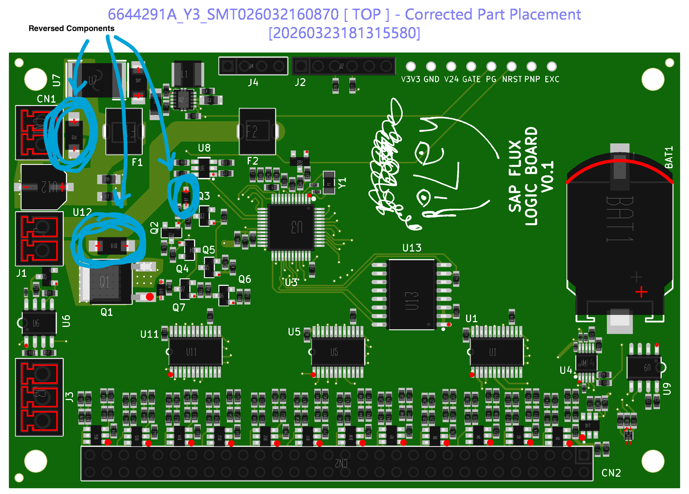
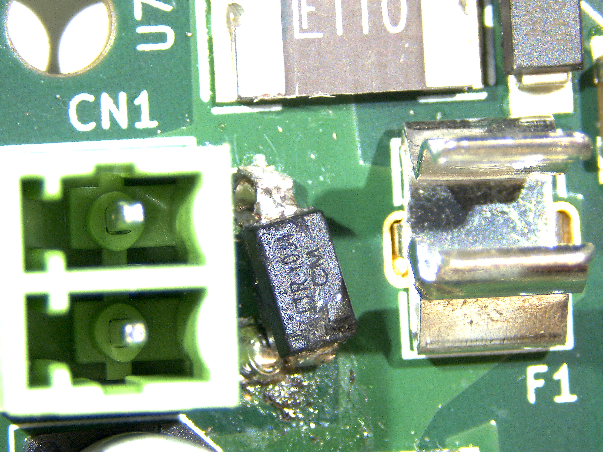
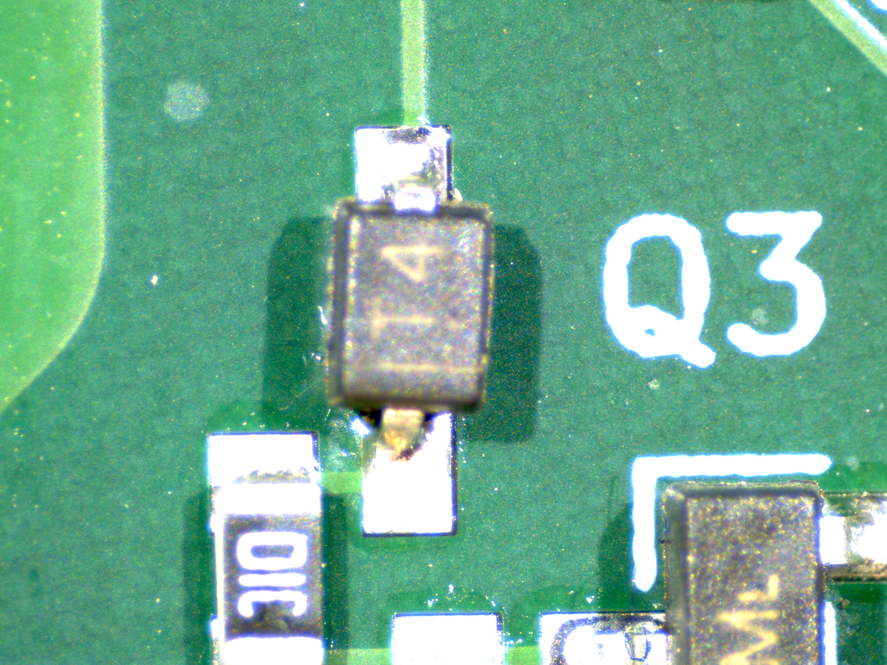
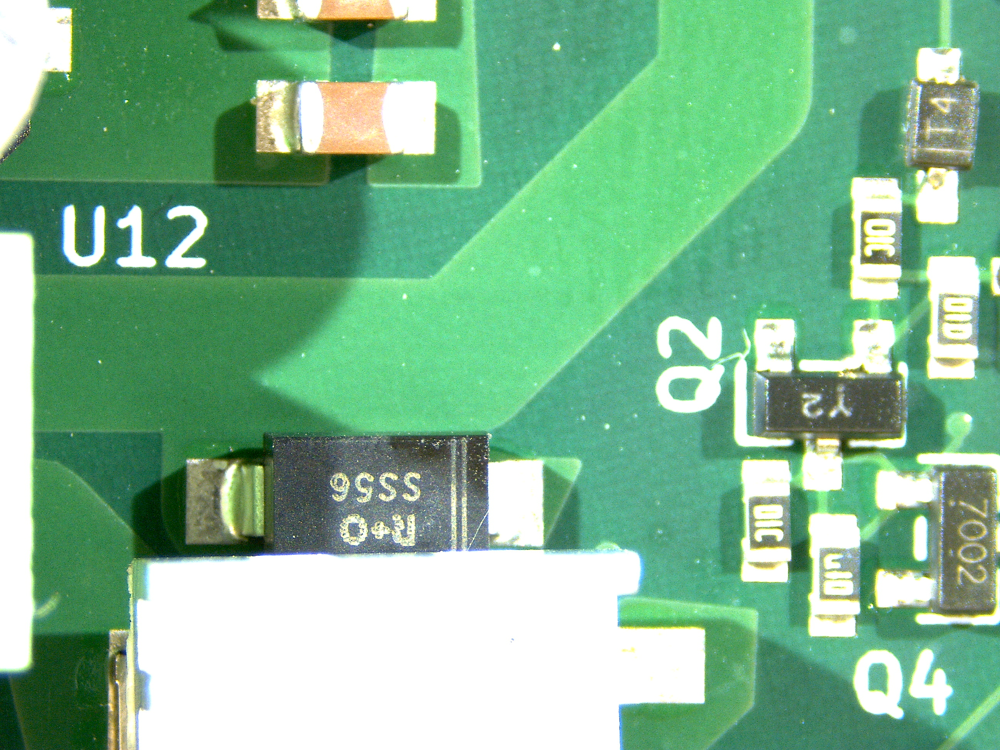

# JLCPCB Order Errors

### Riley Leff
### June 2026
### Order: `SMT026032160870` / `W2026032010337545`

Hi, I found that my PCBA had three two-terminal polarized diodes installed with the cathode stripe positioned opposite the one specified in my files and confirmed by JLC: `D2`, `D7`, and `D18`.

This is the component orientation I confirmed before assembly, see the blue annotations for the three components of interest:

## Overview

| Ref | Part | Expected from confirmed orientation | Observed on assembled board | Evidence |
| --- | --- | --- | --- | --- |
| `D2` | `SMAJ33A`, `C693627` | cathode/stripe on pad 1, `V24_RAW`; anode on pad 2, `GND` | stripe was on `GND` side; part failed short immediately on 24 V input | post-failure photo, short cleared after D2 removal |
| `D7` | `1N4148WS`, `C2128` | cathode/stripe on pad 1, `NRST`; anode on pad 2, `d_iso_anode_node` | stripe on bottom pad; top pad continuity to `NRST`, bottom pad no continuity to `NRST` | microscope photo plus continuity check |
| `D18` | `SS56`, `C18199169` | cathode/stripe on pad 1, `heater_hi`; anode on pad 2, `heater_lo` | stripe on right side, closer to `Q2`, which is the `heater_lo` side | microscope photo |

## Details And Photos

### D2

This reversed diode caused an immediate short when I plugged in power for the first time and blew itself out. I removed the part to eliminate the short and continue testing the board, but replaced it for the photo below.

Submitted orientation:

- `D2` pad 1 (upward, in this image) is `V24_RAW`.
- `D2` pad 2 is `GND`.
- The confirmed orientation above maps pin 1 to cathode and pin 2 to anode.

Observed:

- The delivered board had the D2 cathode stripe on the `GND` side.

### D7

Submitted orientation:

- `D7` pad 1 (upward, in this image) is `NRST`.
- `D7` pad 2 is `d_iso_anode_node`.
- The confirmed orientation maps pin 1 to cathode and pin 2 to anode.

Observed:

- The stripe is oriented towards the bottom pad.
- Continuity check: top pad is continuous with the `NRST` test pad.
- Continuity check: bottom pad is not continuous with the `NRST` test pad.

### D18

Submitted orientation:

- `D18` pad 1 (left, in this image) is `heater_hi`.
- `D18` pad 2 is `heater_lo`.
- The submitted part wrapper maps pin 1 to cathode and pin 2 to anode.

Observed:

- The physical stripe is on the right side, closer to `Q2`.
- That is the `heater_lo` side, opposite the submitted orientation.

## Relevant Files

If the submitted design files are not currently available on your end, the frozen copy of the release I submitted is available on GitHub:

- [Frozen submitted release folder](https://github.com/RileyLeff/sapflux_sensor/tree/main/releases/sap-flux-adapter-v1.1-shipped-2026-03-21)
- [Submitted KiCad board file](https://github.com/RileyLeff/sapflux_sensor/blob/main/releases/sap-flux-adapter-v1.1-shipped-2026-03-21/default.kicad_pcb)
- [Submitted JLC BOM](https://github.com/RileyLeff/sapflux_sensor/blob/main/releases/sap-flux-adapter-v1.1-shipped-2026-03-21/gerbers/jlcpcb-bom.csv)
- [Submitted JLC CPL / centroid file](https://github.com/RileyLeff/sapflux_sensor/blob/main/releases/sap-flux-adapter-v1.1-shipped-2026-03-21/gerbers/jlcpcb-cpl.csv)

## Ideal Outcome For Me

I would prefer a refund or JLCPCB account credit rather than a remake of the same revision, because I am preparing an updated board revision with clearer polarity/orientation markings before placing the next order.

I appreciate you taking the time to review this, please let me know if you have any questions or need any additional information!

Best,
Riley